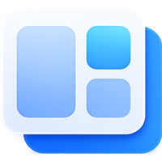
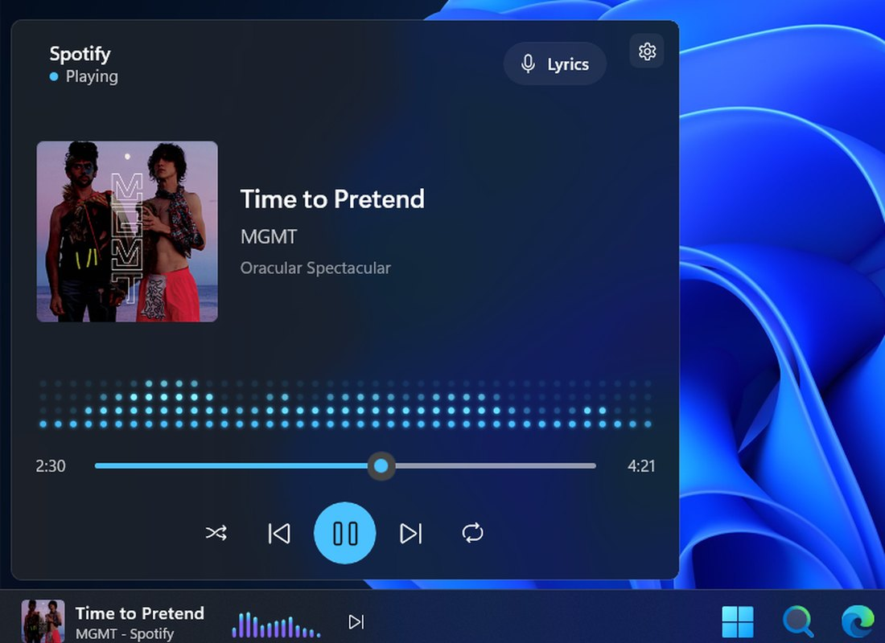
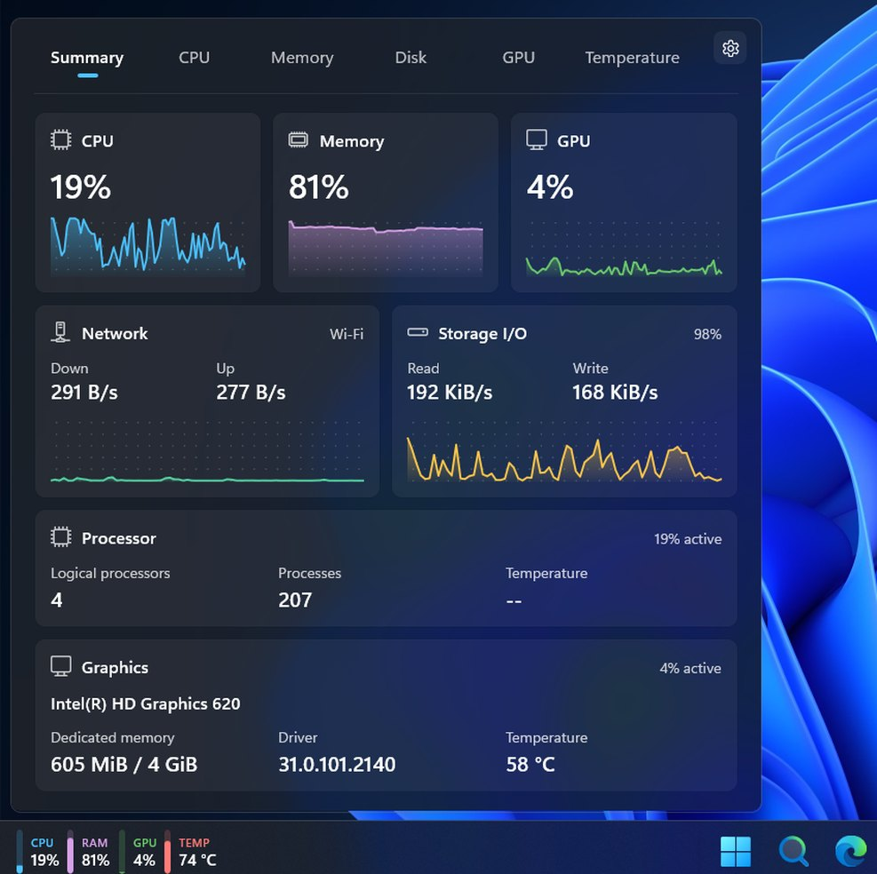
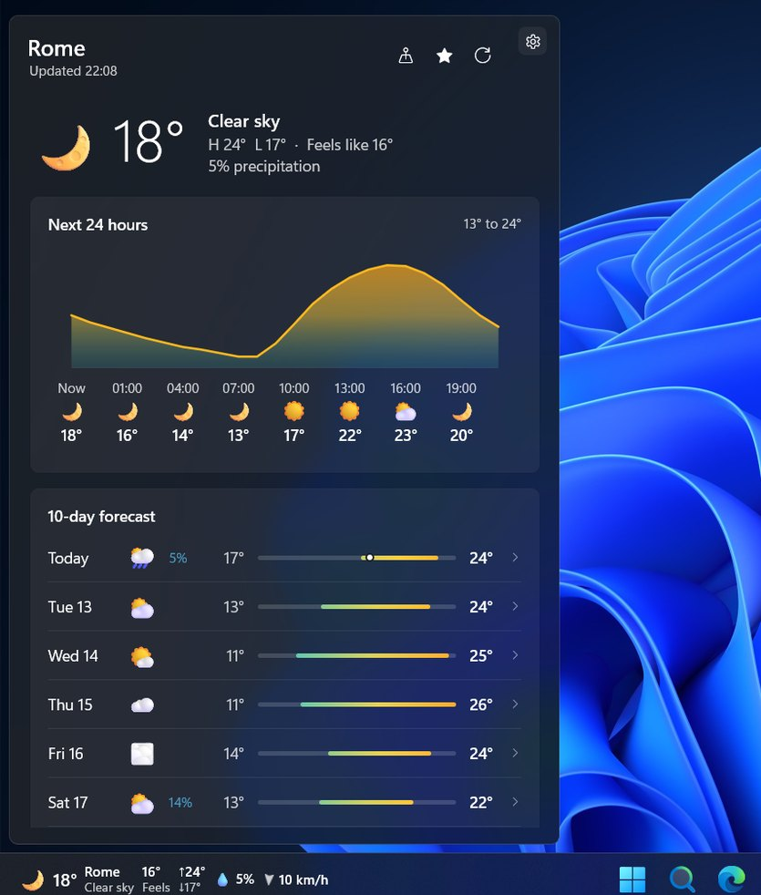
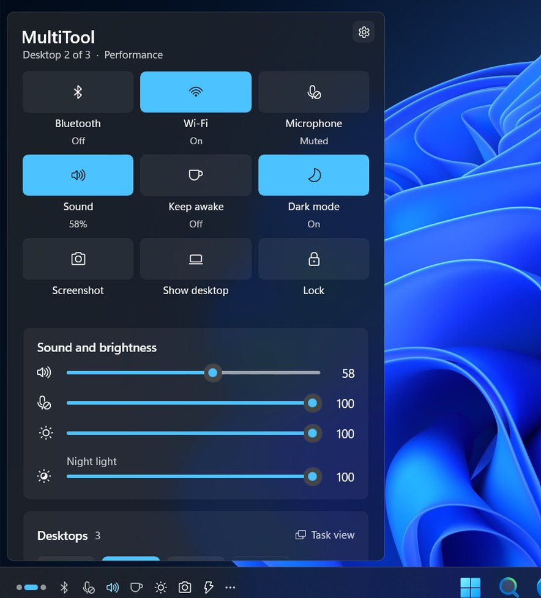
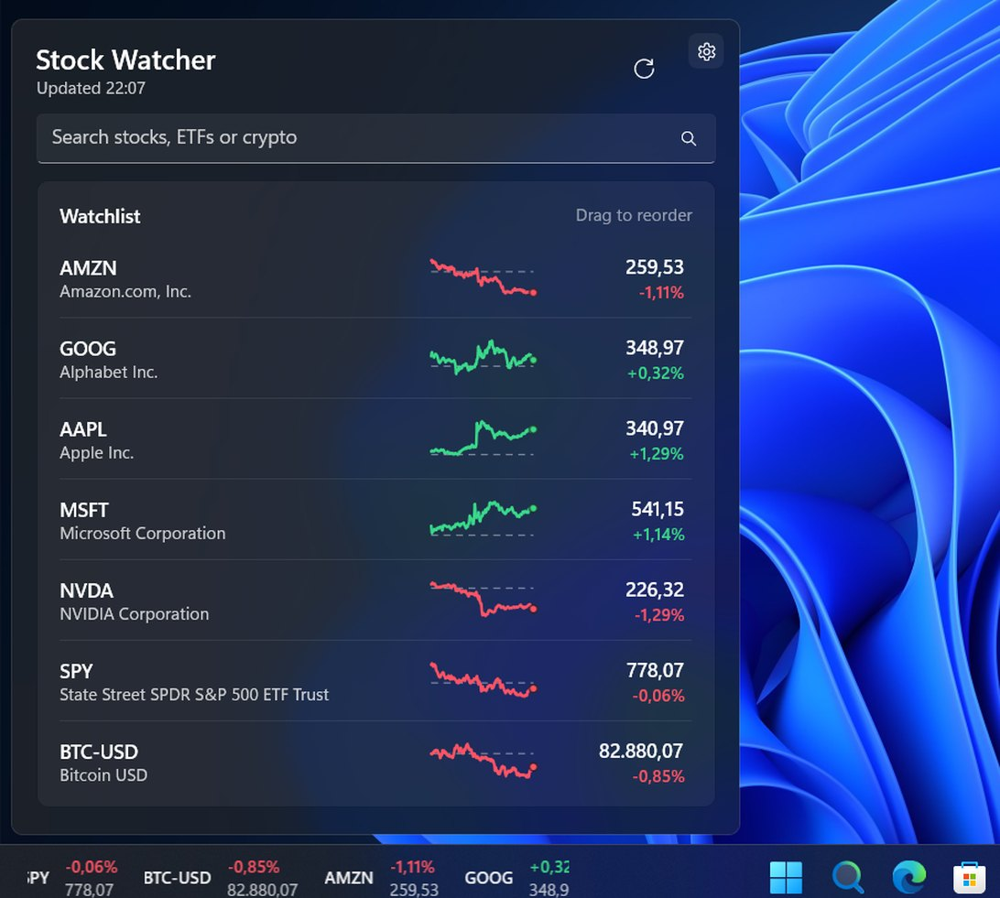
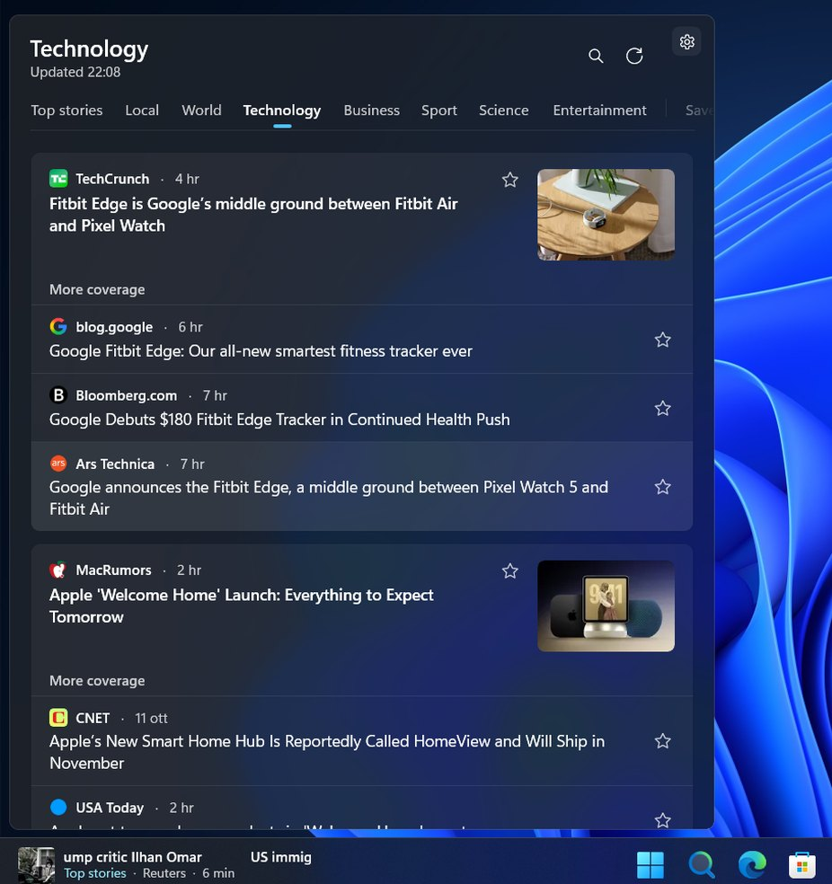

<p align="center">
  
</p>

<h1 align="center">WidBar</h1>

<p align="center">
  Live widgets on the Windows 11 taskbar: music, weather, system stats, stocks, news and more.
</p>

<p align="center">
  <a href="https://apps.microsoft.com/detail/9PKLDNM83TP9?mode=direct"></a>
</p>

<p align="center">
  <a href="https://github.com/andelby/widbar/releases"></a>
  <a href="#install"></a>
  <a href="https://www.nuget.org/packages/WidBar.SDK"></a>
  <a href="https://github.com/andelby/widbar/issues"></a>
</p>

WidBar puts widgets in the empty space of your taskbar, right next to your apps. Each one shows something useful at a glance and opens a full panel when you click it. Widgets are small apps of their own: install the ones you want and WidBar picks them up. You place them from WidBar's Layout page, and a Smart Stack can share one spot between several widgets.

## Screenshots

<table>
  <tr>
    <td width="50%"><br><b>Media</b>: what's playing, with controls, a live visualizer and synced lyrics.</td>
    <td width="50%"><br><b>System Metrics</b>: CPU, memory, GPU, network, storage and temperatures.</td>
  </tr>
  <tr>
    <td><br><b>Weather</b>: current conditions, the next 24 hours and 10 days ahead.</td>
    <td><br><b>MultiTool</b>: quick toggles, sound, brightness, night light and virtual desktops.</td>
  </tr>
  <tr>
    <td><br><b>Stock Watcher</b>: your watchlist, with a ticker on the taskbar.</td>
    <td><br><b>News</b>: top stories by section and region.</td>
  </tr>
</table>

## Widgets

| Widget | What it does | Store id |
| --- | --- | --- |
| System Metrics | Live CPU, memory, GPU, storage, network and temperature metrics. | [9NM2BN1X33CQ](https://apps.microsoft.com/detail/9NM2BN1X33CQ) |
| Media | See and control music, video and browser playback from the taskbar. | [9NBVCHS7JR0C](https://apps.microsoft.com/detail/9NBVCHS7JR0C) |
| Weather | Current conditions and forecasts directly on the taskbar. | [9N4CS86Q7NV2](https://apps.microsoft.com/detail/9N4CS86Q7NV2) |
| Calendar | Your day, your meetings and every calendar on the taskbar. | [9N4FFRZ709RM](https://apps.microsoft.com/detail/9N4FFRZ709RM) |
| News | Top stories and trusted coverage on the taskbar. | [9PGD54S2M2WR](https://apps.microsoft.com/detail/9PGD54S2M2WR) |
| Stock Watcher | Follow your favorite stocks from the taskbar. | [9MWK4X22QL4M](https://apps.microsoft.com/detail/9MWK4X22QL4M) |
| Pomodoro Focus | Pomodoro timer and stopwatch. | [9NWRJ4D65DHS](https://apps.microsoft.com/detail/9NWRJ4D65DHS) |
| Shelf | Keep files, folders and clipboard items within reach. | [9P18QNL4TC4G](https://apps.microsoft.com/detail/9P18QNL4TC4G) |
| MultiTool | Virtual desktops, quick toggles, window snapping and power mode. | [9PPRS4PD8PBT](https://apps.microsoft.com/detail/9PPRS4PD8PBT) |

## Install

WidBar needs Windows 11 on an x64 or ARM64 PC. Install WidBar first, then the widgets you like.

### Microsoft Store

The easiest way. The Store also keeps WidBar and the widgets up to date: [WidBar on the Microsoft Store](https://apps.microsoft.com/detail/9PKLDNM83TP9).

### winget

```powershell
winget install --id 9PKLDNM83TP9 --source msstore
```

Widgets install the same way, with the Store ids from the table above.

### GitHub releases

Every version of WidBar and of each widget is also published on the [Releases](https://github.com/andelby/widbar/releases) page. The release pipeline (GitHub Actions) builds and signs them from the same code as the Store versions, and each release lists the issues it fixes. A release has:

- `<App>_<version>_x64_arm64.msixbundle`: the app, for x64 and ARM64
- `WidBar.cer`: the certificate the package is signed with
- `<App>_<version>_Dependencies.zip`: framework packages, in case Windows asks for them
- `SHA256SUMS.txt`: checksums

The packages are signed with the developer's own certificate, so Windows has to be told to trust it once. In PowerShell as administrator:

```powershell
Import-Certificate -FilePath .\WidBar.cer -CertStoreLocation Cert:\LocalMachine\TrustedPeople
```

Then double-click the `.msixbundle`. The same certificate covers WidBar and every widget, so this is needed only once.

## Report a bug or suggest something

Open an [issue](https://github.com/andelby/widbar/issues/new/choose). The bug form asks for what usually matters (version, Windows build, displays and taskbar) and says where to find the logs. When a fix ships, the issue gets closed with a link to the release that has it.

## Build your own widget

Widgets are WinUI 3 apps built on [WidBar.SDK](https://www.nuget.org/packages/WidBar.SDK). Start from the [widget template](https://github.com/andelby/widbar-widget-template): its wiki covers the taskbar preview, the flyout, settings and packaging.

## This repository

It holds the [website](https://widbar.app), the widget catalog (`catalog.json`) that WidBar's Showcase page reads, the issues and the releases. WidBar's source code is not here. The privacy policy is at [widbar.app/privacy.html](https://widbar.app/privacy.html).

To add or update a widget in the catalog, edit its entry in `catalog.json` (add a category first if needed). Every entry needs a unique `id`, the WidBar AppExtension `pluginId`, the Microsoft Store `storeProductId`, a category, publisher, name, summary and description, and a public icon URL. Keep `schemaVersion` at `1` until WidBar reads a newer format.
